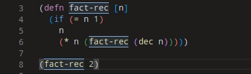
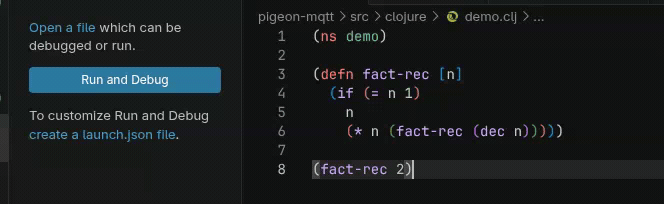
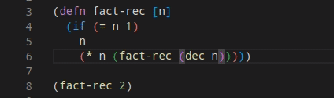
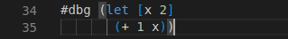
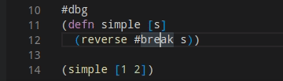
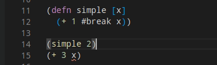
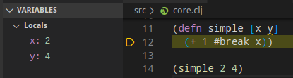
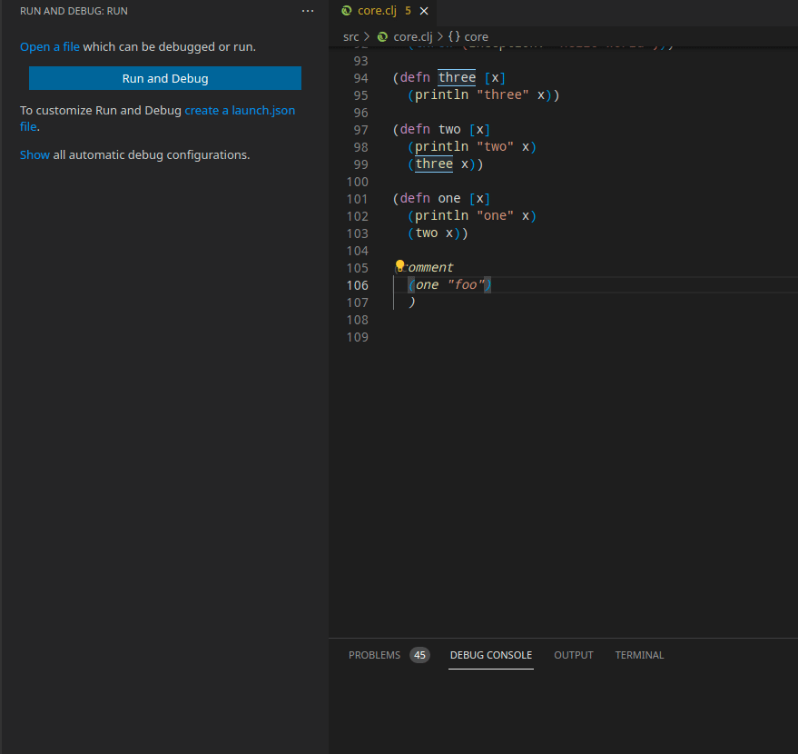
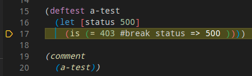

# Debugger

Calva comes with a powerful expression-based debugger, inspired by [Cider](https://cider.mx/)'s debugger, and using the same underlying library, [cider-nrepl](https://github.com/clojure-emacs/cider-nrepl). We hope you love it!



Calva supports breakpoints set in Clojure code with `#break` or `#dbg`, as well as breakpoints set in the editor gutter. Both approaches use the VS Code debug toolbar to control execution. Gutter breakpoints are implemented through reader instrumentation, using `#break` and, where needed, `#dbg`.



!!! note
    The debugger currently does not support ClojureScript. Calva uses cider-nrepl for debugging. See [this CIDER issue](https://github.com/clojure-emacs/cider/issues/1416) for more information.
    JVM Clojure with debugger-capable `cider-nrepl` middleware is the known supported setup for Calva's full expression debugger. GUI source breakpoints are enabled when the active nREPL session advertises the required `init-debugger` and `debug-input` operations. Other dialects or servers may work when they advertise both operations; Calva does not enable GUI breakpoint instrumentation based on file extension alone.

## Features

### Current

* Instrument functions for debugging with `ctrl+alt+c i`
* Instrument a function manually with `#dbg` (as an alternative to the command above)
* Set individual breakpoints with `#break`
* Continue to next breakpoint
* Step over form
* Step into form
* Step out of form
* Evaluate code in the debug context
* See variable values in the debugger side pane
* See variable values on hover in the editor

### Future goals

* See structured variables in the debugger side pane (currently maps and collections are just shown as strings)
* Inject values into the debug context
* Trace: continue, printing expressions and their values

## Dependencies

The debugger itself relies pretty heavily on [cider-nrepl](https://github.com/clojure-emacs/cider-nrepl), as do other parts of Calva. This library is loaded as a dependency when you use Calva Jack-in. If you are not using Calva Jack-in, you can add these dependencies in your project definition or user profile. See the [Calva Jack-in guide](jack-in-guide.md) for more information.

## Using the Debugger

If you're new to Clojure or expression-based debuggers, this debugger may work differently from what you're used to. For the expression-based debugger, use the Clojure reader tags `#break` and `#dbg` to mark breakpoints in a form. When you evaluate a call to a function instrumented with one of these tags, the debugger starts when execution reaches the first breakpoint. You can also use a convenience command to instrument functions. Calva's gutter breakpoints use the same reader tags behind the scenes; see [GUI Breakpoints in the Editor Gutter](#gui-breakpoints-in-the-editor-gutter) for how to use them.

!!! note
    The debugger is not configured via a `launch.json` file, and is not started in the same way as you may be used to when working with other languages in VS Code. The debugger is used by way of the REPL. If you are new to Clojure, please visit the [Getting Started](getting-started.md) section of the documentation and get familiar with evaluating code using the REPL before using the debugger.

### Instrumenting a Function

You can instrument a top-level function for debugging with `ctrl+alt+c i`. This places invisible breakpoints throughout the function at points where pausing makes sense. When you evaluate a call to this function, the debugger starts and execution pauses at the first breakpoint. Annotations show the value of the form at the cursor.

A border is placed around the definition of the instrumented function and its references to show that it's instrumented. You can remove instrumentation by evaluating the function again normally, such as with `alt+enter`.



### Setting Breakpoints with `#break`

You can insert a breakpoint manually by placing `#break` before the form where you want execution to pause, then evaluating the top-level form with `alt+enter`. When you evaluate a call to this code, the VS Code debugger starts, the cursor moves to just after the form preceded by `#break`, and the line is highlighted to show that execution is paused there.


!!! note
    Code will be executed up to and *including* the form after the breakpoint.

### GUI Breakpoints in the Editor Gutter

You can also add breakpoints by clicking the editor gutter. Calva implements them by inserting `#break` before the target form and, when needed, `#dbg` around a function body. Calva uses the active nREPL session's advertised debugger operations to decide whether it can instrument them. If either `init-debugger` or `debug-input` is unavailable, the VS Code markers may remain visible, but Calva reports them as unverified and evaluates forms without breakpoint instrumentation. The notification names the missing operations. Connecting to an unsupported session by itself does not show a warning; feedback appears when you request breakpoint behavior.

You do not press F5 to start debugging. Calva re-evaluates the containing top-level form to install the breakpoint, and execution pauses when it reaches the instrumented form. If the breakpoint is inside a function definition, evaluating the definition only installs the breakpoint; it does not call the function. Evaluate an expression that calls the function to reach the breakpoint. If the breakpoint is in an executable top-level expression, such as an `if` form, Calva re-evaluates that expression and pauses when it reaches the breakpoint.

For example, a gutter breakpoint inside this function is reached when you evaluate a call such as `(fact-rec 5)` after the function definition has been instrumented:

```clojure
(defn fact-rec [n]
  (if (= n 1)
    n
    (* n (fact-rec (dec n)))))
```

A breakpoint inside an executable top-level form is reached when Calva re-evaluates that form. For example:

```clojure
(let [n 1]
  (if (= 1 n)
    (print "one")
    (print "more than 1")))
```

Because adding a gutter breakpoint re-evaluates its containing top-level form, that evaluation can repeat side effects. Editing a breakpoint condition or removing a marker does not itself re-evaluate the form; evaluate the updated top-level form again to apply the condition or source change. Removing a marker does not undo code that has already run, and runtime breakpoint cleanup can depend on the debugger middleware version.

### Conditional Breakpoints

For a GUI breakpoint in the editor gutter, right-click the breakpoint marker and choose **Edit Breakpoint...**. Enter a Clojure expression in the condition field. Calva passes the expression to `cider-nrepl` as the `:break/when` condition, and execution pauses at that breakpoint only when the condition is true. Re-evaluate the containing top-level form to apply a new or changed condition.


You can also set a condition in code by adding metadata before the form that `#break` applies to:

```clojure
(defn print-nums [n]
  (dotimes [i n]
    #break ^{:break/when (= i 7)} ;; This breakpoint is hit only when i equals 7
    (prn i)))
```

### Instrumenting a Form with `#dbg`

Adding `#dbg` before a form and then evaluating it with `alt+enter` instruments the form. This has the same effect as using [the instrument command](#instrumenting-a-function).





### Evaluating Code in the Paused Context

When execution is paused at a breakpoint, you can evaluate code in that context. This can be done in the editor or in the REPL window, as usual.



### Viewing Variable Values

While debugging, you can view variable values in VS Code's debugger side pane or by hovering over variables in the editor.



!!! Note "Metadata not available"
    The variable viewer does not have access to any metadata attached to the variable values.

### Viewing the Call Stack

While debugging, you can view the call stack in VS Code's Call Stack pane. Clicking a stack frame shows the related line of code in an editor.

!!! Note
    You may see only one stack frame in the Call Stack pane because support for additional frames was rolled back due to an issue. You can follow the discussion at [#1150](https://github.com/BetterThanTomorrow/calva/issues/1150).



### Stepping Commands

You can use VS Code's debugger UI to advance execution while debugging.


!!! note
    Clicking Restart does nothing because this functionality does not make sense for our debugger.

* **Continue** — continues without stopping at the current breakpoint.
* **Step over** — continues to the next breakpoint
* **Step in** — steps into the function about to be called. If the next breakpoint is not around a function call, this behaves like Step over. Note that you can step into only normal functions stored in vars for which cider-nrepl can find the source. You cannot currently step into multimethods, protocol functions, or functions in `clojure.core`, although you can instrument multimethods and protocols manually
* **Step out** — steps to the next breakpoint outside the current s-expression
* **Restart** — does nothing. To restart debugging, disconnect or continue execution through the final result, then re-evaluate the expression that started the debugger
* **Disconnect** — disconnects the debugger

## Caveats

### Breakpoints in loop/recur

One construct where the debugger is limited is `loop`/`recur`. As recur always has to appear in a tail-position inside a `loop` or a `fn` and the debugger uses macros to interleave breakpoints in the forms, it **might** happen that a `recur` no longer appears in a tail position. In that case we have to avoid setting up the breakpoint. An example of such a case is:

```clojure
(loop [i 0]
  #break
  (when (< i 10)
    (println i)
    (recur (inc i))))
```

Here the breakpoint is exactly in front of a form that contains as its last expression a `recur` which is wrapped in a loop. This breakpoint has no effect. This does not mean you cannot use the debugger with `loop`, it just means you have to set your debug statements more carefully.

### Loading the File and "Eval On Save"

When you load a file, any breakpoints that were previously set in functions will be unset if you are using `nREPL` versions older than 1.5.0 or `cider-nrepl` versions older than 0.58.0. Starting with `nREPL` 1.5.0 together with `cider-nrepl` 0.58.0, breakpoints persist when the file is reloaded. If you have the "Eval On Save" setting enabled, saving the file will reload it; this only removes breakpoints when you're on older versions of these dependencies.

!!! Note
    If you want to know how to configure the versions of the dependencies that Calva Jack-in injects, see [Customizing Calva - Jack-in Dependency Versions](customizing-jack-in-and-connect.md#jack-in-dependency-versions).

## Clashes with Emacs/CIDER debugger

When both CIDER and Calva are connected to the same REPL, stepping through code in one editor may cause execution to stop at a breakpoint set in the other editor. This issue was reported [here](https://github.com/BetterThanTomorrow/calva/issues/2496).

## Troubleshooting

### Debugger hangs when stepping over infinite seqs

This happens because the debugger evaluates a form when stepping over it. If `clojure.core/*print-length*` is `nil` (the default), evaluation of an infinite sequence will never complete. Before debugging a form with an infinite sequence, set `*print-length*`. For example:

```clojure
(set! *print-length* 3)
;; Or, to be more precise
(set! clojure.core/*print-length* 3)
```

Calva does not set this during debugging, so you can choose the value.

### My breakpoint isn't being hit

Your breakpoint may be in a place where cider-nrepl cannot pause execution. For example, a breakpoint before a literal number will not be hit because there is no need to show the value of a literal.

```clojure
(defn simple [x]
  (+ 1 #break 1)) ;; This breakpoint will not be hit
```

Another possible issue is that you're loading the file again after setting breakpoints, which unsets them when you're using `nREPL` versions older than 1.5.0 or `cider-nrepl` versions older than 0.58.0. See [Loading the File and "Eval On Save"](#loading-the-file-and-eval-on-save) under Caveats for more details and how newer versions preserve breakpoints.

### My breakpoint in a test isn't being hit

If you use a test command such as "Run current test," breakpoints will not be hit. Calva loads the file before running tests to ensure that it runs the latest test code. Loading the file unsets breakpoints.

To hit a breakpoint in a test, evaluate the test form with a breakpoint tag, then call the test directly.



### Breakpoints in web server handler functions

When debugging handler functions for Ring, Pedestal, or similar web frameworks, breakpoints may not be hit even after instrumenting the function. This is typically because the route table holds a reference to the original (uninstrumented) version of the function.

**For Ring:** Use a var-quoted handler (`#'handler`) when starting the server so that it always resolves the current version of the function:

```clojure
(run-jetty #'handler {:port 3000 :join? false})
```

**For Pedestal:** Routes may need to be re-evaluated after instrumenting a handler. If your routes are defined with `defroutes`, evaluate the `defroutes` form again after instrumenting the handler function, then call the endpoint.

Also note these limitations when debugging web handlers:

- The debugger session does not automatically disconnect after the HTTP response is returned — you must disconnect manually.
- While the debugger is paused, the REPL is blocked. If the endpoint is hit again while paused, the breakpoint will be hit a second time after you continue, but no REPL evaluation is possible until you disconnect.

### "No reader function for tag" error

If you get an error like this, it's likely that you connected to a REPL instead of jacking in, and you don't have the proper dependencies loaded in your REPL. You can run the command "Copy Jack-in Command Line to Clipboard" to see what command would be run if you jacked in.

Most importantly, make sure you have `cider/cider-nrepl` as a dependency, and `cider.nrepl/cider-middleware` as middleware loaded in your REPL. For example, this is a jack-in command line for a deps.edn project:

```sh
clojure -Sdeps '{:deps {nrepl/nrepl {:mvn/version,"0.8.3"},cider/cider-nrepl {:mvn/version,"0.25.8"}}}' -m nrepl.cmdline --middleware "[cider.nrepl/cider-middleware]"
```

## Passing options to the REPL JVM

Sometimes Clojure debugging tools are not enough for the task. For example, you may want to set breakpoints in an open-source Java library. In these cases, start the JVM in debug mode.

Typical use cases:

* Change Java logger configuration for the REPL via java system properties: e.g `-Dorg.slf4j.simpleLogger.defaultLogLevel=TRACE`
* Enable JVM debugger, change VM memory size, etc.

Calva lets you pass environment variables through `jackInEnv`.
You can set this option in the VS Code `settings.json` file.

You can configure the global `settings.json` file or a project-wide version at `<project-root>/.vscode/settings.json`.

Configuring the global option will impact all projects you work on using Calva, so be aware.
See [the documentation for `settings.json`](https://code.visualstudio.com/docs/getstarted/settings) for more information.

The following snippet configures the `JAVA_TOOL_OPTIONS` environment variable.
It sets the slf4j-simple logging level with a Java system property (`-D`) and adds JVM-specific options (`-X`).

NOTE: You can of course pass other env variables here.

.vscode/settings.json

```json
{
    "calva.jackInEnv": {
        "JAVA_TOOL_OPTIONS": "${env:JAVA_TOOL_OPTIONS} -Dorg.slf4j.simpleLogger.defaultLogLevel=TRACE -Xdebug -Xrunjdwp:transport=dt_socket,server=y,suspend=n,address=7896"
    }
}
```

After you save the file, the JVM reads this variable the next time you `Jack in` to the project and applies the configuration.

You should see something like the message below in the Calva jack-in terminal:

```shell
clojure -Sdeps '{:deps {nrepl/nrepl {:mvn/version,"0.8.3"},cider/cider-nrepl {:mvn/version,"0.26.0"}}}' -A:debug -m nrepl.cmdline --middleware "[cider.nrepl/cider-middleware]"
Picked up JAVA_TOOL_OPTIONS:  -Dorg.slf4j.simpleLogger.defaultLogLevel=TRACE -Xdebug -Xrunjdwp:transport=dt_socket,server=y,suspend=n,address=7896
Listening for transport dt_socket at address: 7896
nREPL server started on port 46691 on host localhost - nrepl://localhost:46691
```
